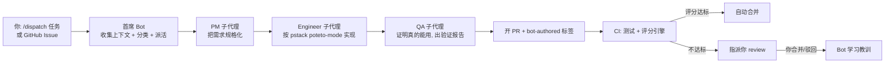

# ai-bot-team

照搬 Lauren Tan（xAI Grok Bot，"土豆女神"）工作法的通用模板：

> **Bot 负责收集上下文和派活，Agents 干实际工程活，pstack 工程技能库保证实现和验证质量；你本人从"盯每个 PR"逐渐过渡到让部分 AI 写的 PR 自动合并。**

运行时基于 **Claude Code**（本地 CLI + GitHub Actions 双栖），技能库用 Lauren 开源的 **pstack**（MIT），放权用本模板自带的**混合信任评分引擎**（评分 + 目录风险 + 任务类型）。



## 目录结构

```
ai-bot-team/
├── .claude/
│   ├── settings.json          # 权限配置
│   ├── commands/
│   │   ├── dispatch.md        # /dispatch 首席 Bot 入口（本地）
│   │   └── review.md          # /bot-review 评审入口（本地）
│   └── agents/
│       ├── pm.md              # 规格化子代理
│       ├── engineer.md        # 干活子代理（挂 pstack 纪律）
│       ├── qa.md              # 验证子代理（prove-it-works）
│       └── reviewer.md        # 评审子代理（interrogate 风格）
├── config/
│   ├── trust.json             # 渐进放权配置（评分阈值/目录风险/任务类型/上限）
│   ├── routing.json           # 任务类型 → 子代理 + pstack playbook 路由
│   └── verification/          # QA 验证报告落盘处（.gitkeep）
├── scripts/
│   ├── trust-score.mjs        # 混合信任评分引擎（零依赖，本地/CI 通用）
│   ├── build-dispatch-prompt.mjs  # CI 派活提示词构建
│   ├── install-pstack.ps1     # Windows 安装 pstack
│   └── install-pstack.sh      # Linux/macOS 安装 pstack
├── .github/workflows/
│   ├── bot-dispatch.yml       # CI 里的 Bot（issue 触发/手动触发）
│   └── verify-and-merge.yml   # 校验 + 评分 + 渐进自动合并
├── football/                  # 可复算的泊松足球分析流水线（台账/门禁/规则登记，见 football/README.md）
└── demo/                      # 演示项目（Node.js 小工具，含测试）
```

## 快速开始

### 第 0 步：装 Claude Code 和 pstack

```powershell
npm install -g @anthropic-ai/claude-code
# Windows：
powershell -ExecutionPolicy Bypass -File scripts/install-pstack.ps1
# Linux/macOS：
bash scripts/install-pstack.sh
```

安装脚本会优先走官方插件方式（`cursor/plugins` 市场里的 `pstack@cursor-plugins`），失败时给出 `npx skills add backnotprop/pstack` 社区镜像的替代方案。装完后在 Claude Code 里跑一次 `/pstack:setup-pstack` 选择各角色的模型（没有 Grok/Codex 就全选 Claude 模型，`pstack@cursor-plugins` 会把所有角色跑在当前 Claude 模型上）。

### 第 1 步：本地跑通一次闭环（盯每个 PR 阶段）

```powershell
cd ai-bot-team/demo
claude
# 在交互会话里：
#   /dispatch 给 stringy 的 slugify 加一个保留中文的选项，带测试
```

`/dispatch` 会让首席 Bot 收集上下文（repo 结构、现有代码、路由配置），派 PM/Engineer/QA 子代理干活，最后开一个带 `bot-authored` 标签的 PR。**这个阶段你把 `config/trust.json` 里 `autoMergeEnabled` 保持 `false`**，每个 PR 都自己看。

### 第 2 步：把模板复制进真实仓库

把 `.claude/`、`config/`、`scripts/`、`.github/workflows/` 拷进目标仓库（demo 换成你自己的项目），改两处：

1. `config/trust.json` 里的 `owner`（你的 GitHub 用户名，兜底 reviewer）和 `directories`（按你仓库的真实目录分风险档）。
2. `verify-and-merge.yml` 里"安装依赖并测试"一步，改成你项目的真实命令。

GitHub 仓库配置：

- Secrets：
  - `ANTHROPIC_API_KEY`（可选，官方 Claude）：CI 里的首席 Bot 派活需要它；没有就跳过派活。CI 的验证不需要任何模型 key。
  - `BOT_PAT`（可选）：让 Bot / 比赛日工作流开的 PR 也自动触发 `verify-and-merge`。
- Variables：`AUTO_MERGE`（`"true"` 才允许真实合并）、`QA_AGENT_ENABLED`（`"true"` 才额外跑可选的 Claude QA Agent，只作参考）、`BOT_DISPATCH_ON_ISSUE`（`"true"` 才让新 issue 自动触发 Bot）

### 第 3 步：渐进放权路线图

| 阶段 | trust.json 怎么改 | 效果 |
|---|---|---|
| L0 全人工 | `autoMergeEnabled: false`（默认） | 每个 bot PR 都派给你 review，评分只作参考 |
| L1 小范围 | 打开 autoMergeEnabled，保持 `dryRun: true` | 只看演练报告，验证评分引擎判断符合你的口味 |
| L2 低风险自动 | `dryRun: false` | 仅 docs/tests 等低风险目录 + CI 全绿的 PR 自动合并 |
| L3 放量 | 上调 `levels` 里 L2/L3 的 `minScore` 并逐步放宽 `directories` | fix/test/chore 类、评分达标的中风险改动自动合并 |

**例行数据通道**（与上面的评分通道并行）：只改台账、赛程快照、发布页、样本库的 bot PR，CI 全绿且对照 main 证明台账只追加不改写时直接自动合并，不看评分，配置见 `config/trust.json` 的 `routineData`，细节见 `football/README.md`。紧急关闭：仓库变量 `ROUTINE_AUTO_MERGE=false`。

任何阶段你都可以给 PR 打 `bot-review-needed` 标签强制转人工。自动合并只作用于带 `bot-authored` 标签的 PR，你自己的 PR 永不自动合并。

## 信任评分机制（混合放权）

`scripts/trust-score.mjs` 是零依赖的 Node 脚本，本地和 CI 用同一套逻辑：

```
基础分 60
+ CI 全绿 +15（未通过 -40）
+ 复现验证通过 +10（失败 -10）：CI 用 PR 的代码和样本库重算回测台账与模型参数，必须与提交的文件逐字节一致，并复算全部登记规则
+ 任务类型调整（docs +20 / test +15 / fix +10 / chore +5 / feat -5 / refactor -10）
+ 目录风险调整（low +8 / medium -5 / high -15，取改动中最高风险文件）
+ 改动量在安全上限内 +5（超限每项 -10）
+ 改动带测试 +5
→ 0~100 分，映射 L0~L3
→ 决策：自动合并 / 自动合并(演练) / 需人工 review
```

用法：

```powershell
# 手动给一批文件打分
node scripts/trust-score.mjs score --files "docs/a.md,demo/src/b.js" --type fix --ci success --verified true

# 对真实 PR 打分（需要 gh 已登录）
node scripts/trust-score.mjs score-pr 12

# 输出 markdown 版评论
node scripts/trust-score.mjs score-pr 12 --format markdown
```

评分规则全在 `config/trust.json`，改配置不需要改代码。建议每两周回看一次：被人工驳回的 bot PR，用 `/bot-review` 的结论去调 `directories` 或 `levels`，这就是"越用越敢放权"的抓手。

## 没有 Claude API Key 时

本模板不再使用任何第三方兼容端点（已移除 DeepSeek 路线）。

| 环节 | 需要模型吗 | 没有 `ANTHROPIC_API_KEY` 时 |
| --- | --- | --- |
| CI 验证（`verify-and-merge.yml`） | **不需要** | 照常运行：测试 + 8 道门禁 + 复现验证，信任评分照常计算 |
| 足球比赛日 / 样本库刷新 / 发布页上线 | 不需要 | 照常运行 |
| CI 首席 Bot 派活（`bot-dispatch.yml`） | 需要官方 Claude | 自动跳过并提示；改在本地派活 |
| 本地 `/dispatch` | Claude Code 登录 Claude 账号即可 | 不需要 API key |

本地还可以用 Qwen Code CLI 作为国产替代（结构与 Claude Code 最像）：

```powershell
npm install -g @qwen-code/qwen-code
# 登录拿免费额度，或配置 DASHSCOPE_API_KEY / 自定义模型端点
Copy-Item .claude/agents .qwen/agents -Recurse   # 子代理目录同格式（.qwen/agents/ 优先级最高）
Copy-Item .claude/commands .qwen/commands -Recurse
```

- 子代理文件格式与 Claude Code 兼容（`.qwen/agents/` 为项目级目录），frontmatter 不用改。
- 认证和自定义模型见官方文档（qwen-code-docs 中文站）。

另外：GitHub Actions 在国内基本可用但偶有延迟；公司内网完全受限时可改用自托管 runner（workflow 无需改，只换 runner 标签）。

## 常见问题

- **CI 里跑 Bot 怕失控？** `bot-dispatch.yml` 的 `dry_run` 输入默认是 `true`，Bot 只会把"计划"评论在 issue 上，不开 PR。
- **自动合并怕把主分支搞挂？** merge 前置条件：verify 全部通过 + 评分达标 + `AUTO_MERGE=true` + 带 `bot-authored` 标签，四者缺一不可。
- **Windows 本地**：评分引擎和安装脚本都兼容 PowerShell 5 + Node 18+，无其他依赖。

## 许可与来源

- pstack 由 [Lauren Tan (@poteto)](https://github.com/cursor/plugins/tree/main/pstack) 创作，MIT 许可，本模板不包含其代码，仅提供安装脚本与调用规范。
- 本模板本体为示例性质，MIT 许可，可自由复制修改。
